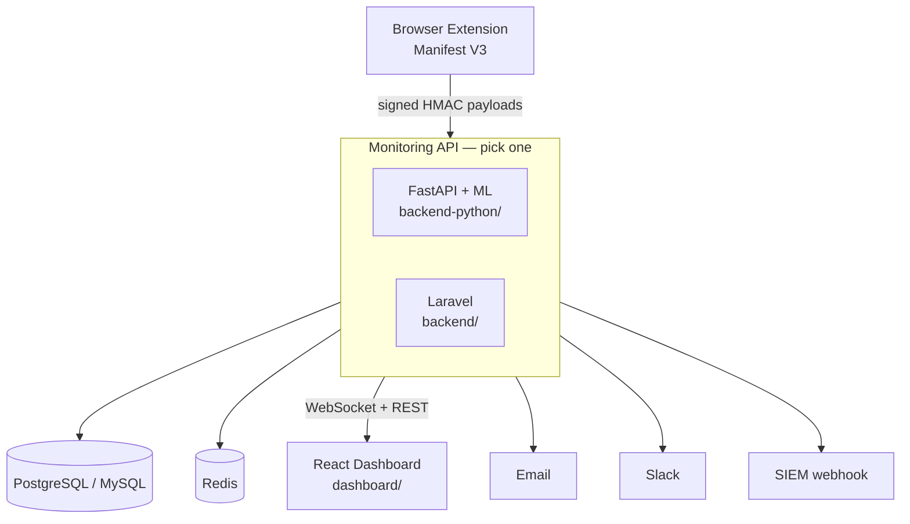

# InfoSec AI Monitor 🔒

Detect and analyse what your organisation is sending to AI platforms — without
ever collecting the text itself.

A browser extension observes AI-platform usage, hashes the content client-side,
and reports **metadata only** to a monitoring API that scores risk, raises
alerts, and feeds a real-time security dashboard.

[](LICENSE)
[](backend-python/)
[](backend/)
[](dashboard/)
[](extension/)

---

## The core idea

Blocking AI tools does not work — people use them anyway, on personal devices.
The useful question is not *"is anyone using ChatGPT?"* but *"is anyone pasting
our customer database into it?"*

This system answers the second question while being unable to answer the first
one invasively:

- The extension computes a **SHA-256 hash** of each prompt and response and
  discards the text. Nothing else ever sees it.
- Pattern matching for credentials, card numbers, SSNs and similar runs
  **client-side**; only the *name* of what matched ("api_key") is transmitted,
  never the matched value.
- The server stores hashes, lengths, risk scores and flags. A hash proves the
  same text was sent twice; it cannot reconstruct the text.

So an analyst can see *"an AWS key pattern was pasted into Claude at 14:03 from
session X"* and act on it, but cannot read anyone's conversations.

---

## Architecture



### Two backends, one contract

The repository ships **two independent implementations** of the same API. Run
whichever suits your stack — you do not need both.

| | `backend-python/` | `backend/` |
|---|---|---|
| Stack | FastAPI, SQLAlchemy 2, Celery | Laravel 12, Eloquent |
| Database | PostgreSQL (SQLite for tests) | MySQL / PostgreSQL / SQLite |
| Risk analysis | Regex rules **plus** optional ML (transformers, isolation forest, spaCy) | Regex rules and heuristics |
| Real-time | Native WebSocket at `/ws/monitor` | Pusher / Laravel broadcasting |
| Best for | ML-driven detection, Kubernetes deployments | Existing PHP infrastructure, simpler operations |

The Python backend is the more capable of the two and is what the dashboard
targets by default.

---

## Project layout

```
.
├── extension/          Chrome/Edge Manifest V3 extension
│   ├── background/     Service worker, HMAC request signing
│   ├── content-scripts/Per-platform DOM observation
│   ├── popup/          Toolbar UI, consent controls
│   └── icons/
├── backend-python/     FastAPI backend (recommended)
│   ├── app/core/       Config, database, logging, security
│   ├── app/api/v1/     REST endpoints
│   ├── app/services/   ML, privacy, alerts, analytics, exports
│   ├── tests/          180 tests, no external services needed
│   └── k8s/            Kubernetes manifests
├── backend/            Laravel backend (alternative)
│   ├── app/            Controllers, models, services, middleware
│   ├── config/         infosec.php, alerts.php
│   └── database/       Migrations
├── dashboard/          React 18 + TypeScript + Vite + MUI
│   └── src/            Pages, components, contexts, hooks
├── DEPLOYMENT_GUIDE.md Production deployment
├── CONTRIBUTING.md     How to work on this
└── SECURITY.md         Reporting vulnerabilities
```

---

## Quick start

The fastest path is Docker Compose, which brings up the Python API, PostgreSQL,
Redis and a Celery worker together.

```bash
git clone https://github.com/mostafaalsaedy/AI-INFOSEC_DETECTOR.git
cd AI-INFOSEC_DETECTOR/backend-python

cp .env.example .env
# Fill in SECRET_KEY, EXTENSION_SECRET and ANONYMIZATION_SALT:
python -c "import secrets; print(secrets.token_urlsafe(48))"

docker compose up -d
curl http://localhost:8000/health
```

<details>
<summary><b>Run the Python backend without Docker</b></summary>

```bash
cd backend-python
python -m venv .venv && source .venv/bin/activate   # Windows: .venv\Scripts\activate
pip install -r requirements.txt                      # add -r requirements-ml.txt for the ML stack

cp .env.example .env                                 # then fill in the three secrets
uvicorn app.main:app --reload
```

Requires Python 3.11–3.13. Interactive API docs are at `/docs` when `DEBUG=true`.
</details>

<details>
<summary><b>Run the Laravel backend instead</b></summary>

```bash
cd backend
composer install
cp .env.example .env
php artisan key:generate
php artisan migrate
php artisan serve
```

Requires PHP 8.2+ and Composer.
</details>

<details>
<summary><b>Run the dashboard</b></summary>

```bash
cd dashboard
npm install
cp .env.example .env      # point VITE_API_URL at your backend
npm run dev               # http://localhost:3000
```

Requires Node 18+. The dev server proxies `/api` and `/ws` to the backend, so
there is no CORS to configure locally.
</details>

<details>
<summary><b>Load the browser extension</b></summary>

1. Open `chrome://extensions` and enable **Developer mode**.
2. **Load unpacked** → select the `extension/` directory.
3. Configure it from the extension's service-worker console:

```js
chrome.storage.sync.set({
  apiEndpoint: 'http://localhost:8000/api/v1',
  extensionSecret: '<the same value as EXTENSION_SECRET>',
});
```

See [extension/README.md](extension/README.md) for details.
</details>

---

## How requests are authenticated

The extension has no user to log in as, so it signs every request instead:

```
X-Extension-Id:         <extension identifier>
X-Extension-Timestamp:  <unix seconds>
X-Extension-Signature:  hex(HMAC-SHA256(secret, "<timestamp>.<body>"))
```

The timestamp is part of the signed message and the server rejects anything
older than five minutes, so a captured request cannot be replayed. Dashboard and
integration traffic uses short-lived JWTs with three roles — `viewer`,
`analyst`, `admin`.

---

## Supported platforms

ChatGPT · Claude · DeepSeek · Perplexity · Cohere · Replicate · Hugging Face ·
Together AI · Mistral AI

Adding another takes three edits — see
[extension/README.md](extension/README.md#adding-a-platform).

---

## Risk detection

Client-side patterns score each interaction 0–100 and map it onto four severity
bands:

| Detects | Examples |
|---|---|
| Credentials | API keys, access tokens, passwords |
| Financial data | Card numbers, bank details |
| Personal data | SSNs, email addresses, phone numbers |
| Classification markers | "confidential", "internal", "proprietary" |
| Security terminology | exploit, backdoor, penetration testing |

With the optional ML stack installed, the Python backend adds transformer-based
classification, isolation-forest anomaly detection and sentiment scoring on top.
Without it, the deterministic pipeline still runs — that is what raises the
majority of alerts anyway.

Alerts are routed to email, Slack and SIEM webhooks. Critical alerts always
send; lower severities respect configured business hours so the on-call rotation
is not paged for low-signal findings.

---

## Privacy and compliance

Designed against GDPR and CCPA requirements from the start:

- **Explicit consent** with a configurable expiry, after which users must
  re-affirm it.
- **Right of access** — full data export per subject, JSON or CSV.
- **Right to erasure** — hard delete, or pseudonymisation that keeps aggregate
  statistics intact.
- **Data minimisation** — hashes and metadata only; no content, ever.
- **Retention limits** — automatic purge on a configurable schedule.
- **Audit trail** — every access, export and configuration change is logged.

> ⚠️ Deploying workplace monitoring carries legal obligations that differ by
> jurisdiction. Consult your legal and works-council representatives before
> rolling this out, and tell the people being monitored.

---

## Testing

```bash
# Python backend — 180 tests, SQLite in-memory, no services required
cd backend-python
pip install -r requirements-dev.txt
ENVIRONMENT=testing pytest

# Dashboard
cd dashboard
npm run type-check && npm run build

# Laravel backend
cd backend
php artisan test
```

CI runs all three on every push and pull request.

---

## Documentation

| Document | Contents |
|---|---|
| [DEPLOYMENT_GUIDE.md](DEPLOYMENT_GUIDE.md) | Production deployment, TLS, scaling |
| [backend-python/README_PYTHON_IMPLEMENTATION.md](backend-python/README_PYTHON_IMPLEMENTATION.md) | FastAPI architecture |
| [backend-python/k8s/README.md](backend-python/k8s/README.md) | Kubernetes manifests |
| [extension/README.md](extension/README.md) | Extension internals and packaging |
| [CONTRIBUTING.md](CONTRIBUTING.md) | Development workflow and standards |
| [SECURITY.md](SECURITY.md) | Reporting a vulnerability |
| [CHANGELOG.md](CHANGELOG.md) | Release history |

Interactive API reference: run the Python backend with `DEBUG=true` and open
`http://localhost:8000/docs`.

---

## Contributing

Issues and pull requests are welcome — see [CONTRIBUTING.md](CONTRIBUTING.md).
For security vulnerabilities, please follow [SECURITY.md](SECURITY.md) rather
than opening a public issue.

## License

[MIT](LICENSE) © Mostafa Alsaedy
